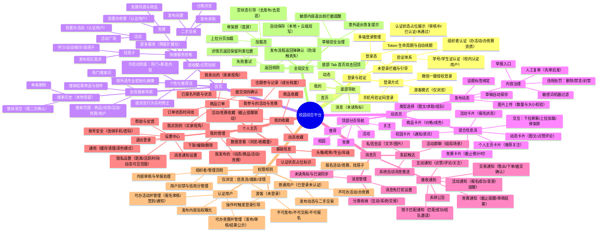

# 校园综合平台 功能脑图（Mermaid Mindmap）

> 使用方式：可直接粘贴到支持 Mermaid 的编辑器（Typora、VS Code + Mermaid 插件、mermaid.live、语雀、飞书文档等）中查看与修改。

## 补充说明（脑图未展开的规则细节）

| 模块 | 规则要点 |
|---|---|
| 游客权限 | 详情可看，任何"写操作"（发布/报名/收藏/私聊）统一触发登录浮层 |
| 认证用户判定 | 学号认证通过后权限自动升级，认证失败保留普通用户权限并提示原因 |
| 推荐冷启动 | 首次登录仅凭"专业"标签；产生 ≥10 次浏览后切换为行为驱动推荐 |
| 草稿 | 发布类页面（动态/商品/活动/竞赛/搭子）统一接入草稿机制，按类型独立存储 |
| 内容治理 | 机器过滤（命中敏感词直接拦截）→ 人工复审（疑似违规）→ 处罚与申诉闭环 |
