# 通航校园APP架构设计 · 思维导图（重构版）

> **重构说明**：本导图以 `通航校园APP架构设计.xmind` 为唯一数据源（共 403 个节点，最大层级 7 级）逐节点完整还原，并按「层级清晰」原则重新组织为结构化文本；同时在文末附等价 Mermaid 源码，可直接粘贴到 Typora / VS Code / mermaid.live 还原为图形化脑图。
>
> **结构主干**：`通航校园APP架构设计` = **主界面设计**（首页 / 动态 / 消息 / 我的 四大 Tab） + **全局导航规则**（底部导航栏 / 权限规则 / 全局交互）。
>
> **阅读约定**：`#`~`####` 为第 0~3 层标题（支持生成目录），第 4 层及以下用缩进列表逐级展开；原图明显的错别字与占位符已在「附录 B」列出并修订。

---

## 一、主界面设计

### 1. 首页

#### 1.1 顶部导航

- 全局搜索
  - 默认提示
    - 搜索动态、帖子和重点消息
  - 搜索历史
    - 展示最近搜索，并支持单条删除与全部清空
  - 热门搜索
    - 展示近期热门动态、帖子和校园话题
  - 搜索结果
    - 按动态、帖子、重要消息、校园话题分类展示
- 消息入口
  - 未读状态
    - 展示推送给用户，但用户未读的消息和提到用户的帖子、动态、话题
  - 点击进入
    - 跳转到消息界面并定位未读的消息

#### 1.2 快捷服务

- 二手服务区
  - 二手商品
    - 展示各个卖家发布的二手商品帖子（两栏）
  - 我的商品
    - 我发布的二手商品帖子
  - 我的关注
    - 我关注的二手商品
  - 我的订单
    - 我出售或买入的二手商品订单
- 搭子服务区
  - 滴搭子帖子
    - 可以筛选不同的爱好，来更快的寻找搭子
  - 我发布的
    - 我发布的滴搭子帖子
  - 我收藏的
    - 我收藏的帖子
  - 我滴过的
    - 我滴成功的搭子
- 活动服务区
  - 学校、组织、个人发布的活动
    - 可以申请参加、表明意愿
  - 我发布的
    - 我发布的活动
  - 我参加的
    - 我参加的活动
  - 我收藏的
    - 我收藏的活动
- 竞赛服务区
  - 找竞赛
    - 进入竞赛目录并使用默认推荐筛选
  - 竞赛日程
    - 按照日历查看报名、初赛、决赛和截止日期
  - 我的收藏
    - 快速查看已收藏或订阅的竞赛

#### 1.3 重要消息

- 活动、商品、服务等待办
  - 即将截止
    - 展示 7 天内截止的活动、帖子、商品、搭子和竞赛
  - 报名开始
    - 展示已开放报名但未报名的活动、竞赛等
  - 规则更新
    - 提示报名的活动、竞赛的规则变化和关注、收藏的商品、搭子的规则变化
- 协作待办
  - 待处理的申请、报名、消息
    - 活动、帖子的发布者查看申请人提交的资料并同意或拒绝
  - 邀请链接
    - 发布活动、帖子的人邀请你的链接选择同意、拒绝或考虑
  - 待完善的资料
    - 提示完善简介、申请说明

#### 1.4 内容推荐

- 机会推荐
  - 推荐帖子
    - 根据专业、喜好、收藏、浏览记录推荐
  - 热门帖子
    - 展示近期热度高的活动、帖子、商品、竞赛等
  - 专业相关
    - 优先展示和本专业相关的帖子、活动、竞赛
- 信息推荐
  - 官方通知
    - 展示通知标题、来源、发布日期和原文链接
  - 规则更新
    - 标明变更字段、时间和其他相关规则
  - 平台公告
    - 展示维护、功能更新与社区治理通知

### 2. 动态

#### 2.1 顶部分类页签

- 推荐
  - 推荐规则
    - 优先展示可以报名或申请的活动、帖子、竞赛和关注的内容
- 关注
  - 关注的内容
    - 只展示已关注的用户、活动、组织和队伍发布的动态
- 活动与竞赛
  - 活动内容和竞赛内容
    - 展示活动的具体内容、时间、人数、地点和要求，竞赛的主题、时间、地点、联系人和要求
- 校园
  - 校园内容
    - 展示二手商品、搭子、活动、交友、游戏、社团、竞赛等

#### 2.2 动态信息流

- 动态卡片
  - 发布者信息
    - 展示昵称、学校标签、发布时间和关注按钮
  - 正文内容
    - 展示文字、图片、话题标签和相关内容
  - 互动数据
    - 展示点赞、评论和收藏数量
  - 卡片操作
    - 支持点赞、评论、收藏、分享、不感兴趣和举报
- 二手商品内容
  - 商品信息
    - 展示商品基本信息，长度、宽度、高度、类型、简介等
  - 图片信息
    - 合规的正面、侧面、背面、上面、下面等展示图
- 找搭子内容
  - 搭子信息
    - 展示性别、爱好、内容、年龄、性格等
- 个人内容
  - 经验分享
    - 分享经验、报名、比赛、活动、答辩和作品制作经验等
  - 学习记录（打卡）
    - 记录课程、技能学习、阶段进展
  - 组队需求
    - 求招、求邀请、缺人、技能、联系方式等
- 活动与竞赛内容
  - 竞赛
    - 获奖信息
      - 展示赛事、奖项、队伍、项目简介和成果图片
    - 备赛过程
      - 分享进度、工具、遇到的问题、阶段成果
    - 比赛复盘
      - 总结时间、任务分工、得失、建议
    - 项目展示
      - 展示项目的名称、技术方向、参赛人员等
  - 活动
    - 校园活动
      - 展示主题、时间、地点、条件和规则等
    - 学术讲座
      - 主讲人、主题、时间、地点、预约方式等
    - 学术调研
      - 调研内容、调研人、面向群体等

#### 2.3 发布动态

- 内容编辑
  - 文字
    - 输入正文并支持草稿自动保存
  - 图片
    - 上传多张图片、预览、排序和删除
  - 话题
    - 选择商品、找搭子、竞赛、活动、学校、技能、校园话题等
  - 关联内容
    - 关联活动、学校、竞赛、技能或校园话题
- 发布设置
  - 可见范围
    - 时间范围、地域范围、隐私范围（公开、私密、仅关注可见）
  - 评论权限
    - 所有人、关注的人、仅自己、关闭
  - 发布确认
    - 检查必填项，社区规范、敏感信息提示

#### 2.4 内容治理

- 举报
  - 举报原因
    - 虚假信息、诈骗、侵权、违规等
  - 举报材料
    - 提交问题说明、截图与链接
- 内容管理
  - 不感兴趣
    - 减少相似内容推荐
  - 屏蔽用户
    - 不再展示对方内容和互动

### 3. 消息

#### 3.1 页面顶部

- 消息分类
  - 全部
    - 按时间展示所有信息
  - 未读
    - 只展示尚未查看或处理的消息
  - 分类入口
    - 活动、竞赛、商品、搭子和系统消息
- 管理操作
  - 全部已读
    - 将当前消息批量标记为已读
  - 消息设置
    - 进入通知开关和免打扰设置

#### 3.2 组队协作

- 申请中心
  - 收到的申请
    - 展示申请人技能、简介、学校及申请理由
  - 处理申请
    - 支持同意、拒绝、补充询问
  - 我的申请
    - 查看待处理、已通过、已拒绝和已撤回的状态
  - 申请详情
    - 展示关联活动、竞赛等
- 团队会话
  - 私聊
    - 支持文字、图片、文件和关联活动、竞赛、商品等卡片
  - 队伍群聊
    - 展示活动成员列表或竞赛成员、公告、重要消息
  - 队伍通知
    - 提示成员加入、退出、角色调整和招募关闭
  - 会话操作
    - 支持置顶、免打扰、举报和删除本地会话记录

#### 3.3 内容互动

- 评论与回复
  - 评论通知
    - 展示评论人、原内容摘要和评论正文
  - 回复通知
    - 展示回复并可以直接进入讨论位置
  - 提及通知
    - 展示动态、帖子和评论中的提及内容
- 点赞与收藏
  - 点赞通知
    - 汇总展示点赞用户和关联内容
  - 收藏反馈
    - 展示内容被收藏情况并进入内容详情
  - 新增关注
    - 展示关注者基本资料和关注入口

#### 3.4 活动与赛事系统

- 活动与赛事提醒
  - 报名开始
    - 展示活动或赛事名称、开放时间和报名入口
  - 即将截止
    - 展示剩余时间并进入报名信息页
  - 赛程与活动提醒
    - 提醒材料提交、开始时间、地点、结束时间
  - 规则变化
    - 展示变化摘要及官方来源
- 系统通知
  - 内容审核
    - 展示通过、退回或下架结果及原因
  - 举报处理
    - 展示处理状态、结果和申诉入口
  - 账号安全
    - 提示异地登录、密码修改和绑定信息
  - 平台公告
    - 展示维护时间、版本更新和重要规则

### 4. 我的

#### 4.1 个人主页头部

- 个人资料卡
  - 基础信息
    - 展示头像、昵称、学校
  - 能力信息
    - 展示专业、技能标签、爱好、性格
  - 数据概览
    - 展示参加的活动、比赛，发布了多少帖子等
  - 编辑资料
    - 修改头像、昵称、简介、专业、技能
- 右上角设置图标
  - 点击行为
    - 进入独立的设置中心页面
  - 状态提示
    - 账号存在安全风险的时候提示标记

#### 4.2 我的商品、活动、竞赛、搭子

- 商品
  - 订单信息
    - 交易时间、交易金额、联系方式等
- 活动
  - 活动记录
    - 进行中
      - 查看当前阶段、下一节点和活动详情
    - 历史活动
      - 按年份、类别查看活动记录
- 竞赛
  - 参赛记录
    - 进行中
      - 查看当前阶段、下一节点和比赛详情
    - 历史竞赛
      - 按年份、类别查看活动记录
  - 成果展示
    - 获奖记录
      - 记录赛事、奖项、年度和证明材料
    - 作品资料
      - 保存项目介绍、演示链接和公开附件

#### 4.3 我的管理

- 组队管理
  - 我的申请
    - 查看申请状态、撤回待处理申请
  - 我的队伍
    - 查看成员、分工、公告和活动、事件或比赛进度
  - 我的招募
    - 编辑条件、处理申请、暂停、或停止招募
  - 收到的邀请
    - 查看邀请队伍并接受或拒绝
- 内容管理
  - 我的动态
    - 查看、编辑、删除、设置可见范围
  - 我的帖子
    - 管理讨论、经验和资料内容
  - 我的评论
    - 查看评论记录并进入原内容
  - 我的收藏
    - 按活动、竞赛、帖子、动态等分类查看
- 个人信息与功能认证
  - 认证状态
    - 未认证
      - 显示仅操作的功能和认证页面
    - 认证中
      - 预留后端返回处理状态
    - 已认证
      - 仅展示状态和可使用的功能范围
    - 未通过
      - 预留原因说明和重新进入入口
  - 认证页面占位
    - 页面内容
      - 说明认证用途、权限变化和隐私边界
    - 接口预留
      - 只保留状态读取和权限判断字段
    - 明确边界
      - 不涉及学信网材料输入、授权和审核流程

#### 4.4 设置中心

- 账号管理
  - 绑定手机号
    - 展示脱敏号码、绑定状态、更换和解除入口
  - 绑定邮箱
    - 展示脱敏邮箱、验证状态、更换和解除入口
  - 修改密码
    - 校验当前密码并设置符合规则的新密码
  - 登录设备
    - 查看设备、最近登录时间和退出其他设备
  - 账号注销
    - 展示影响说明、冷静期和身份确认入口
- 消息通知
  - 组队通知
    - 分别控制申请、邀请、成员变化和会话提醒
  - 活动与比赛通知
    - 分别控制报名、截止、成员变化和会话提醒
  - 商品通知
    - 分别控制商品状态，卖出中、已卖出等
  - 搭子通知
    - 分别控制搭子状态，寻找中、已找到等
  - 互动通知
    - 分别控制评论、回复、点赞、收藏和关注提醒
  - 系统通知
    - 安全和必要服务通知不可完全关闭
  - 免打扰
    - 设置开始时间、结束时间和例外会话
- 隐私设置
  - 资料可见范围
    - 学校、专业、技能或竞赛
  - 动态可见范围
    - 设置默认可见范围和历史动态权限
  - 联系权限
    - 控制谁可以私聊、邀请组队和申请加入
  - 黑名单
    - 查看已屏蔽用户并支持解除屏蔽
  - 个性化推荐
    - 控制是否使用行为数据进行内容推荐
- 通用设置
  - 清理缓存
    - 清理展示缓存大小并清理本地临时数据
  - 字体显示
    - 设置字体大小和深色模式
  - 语言
    - 首版默认简体中文并预留多语言入口
  - 关于平台
    - 展示版本号、用户协议、隐私政策和开源许可
- 帮助与反馈
  - 常见问题
    - 查看账号、活动、赛事、组队消息和内容规则说明
  - 意见反馈
    - 选择问题类型并提交文字图片和联系方式
  - 举报记录
    - 查看举报对象、提交时间、进度和处理结果
  - 联系客服
    - 展示服务时间和官方联系渠道
- 退出登录
  - 确认弹窗
    - 提示退出后认可使用游客模式浏览公开内容
  - 退出结果
    - 清除本地会话并返回登录或游客入口

## 二、全局导航规则

### 1. 底部导航栏

#### 1.1 首页

- 默认入口
  - 展示待办和机会推荐

#### 1.2 动态

- 内容入口
  - 浏览和发布内容动态

#### 1.3 消息

- 写作入口
  - 展示未读角标并处理组队信息

#### 1.4 我的

- 个人入口
  - 管理内容、活动、商品等

### 2. 权限规则

#### 2.1 游客

- 仅浏览相关内容，不能进行操作

#### 2.2 登录用户

- 收藏订阅、管理个人资料，但是不能决定能否发布活动和竞赛组队

#### 2.3 认证用户

- 可以发布一些活动和竞赛等，进行组队等行为

### 3. 全局交互

#### 3.1 返回规则

- 页面返回
  - 返回上级页面并保留列表位置和筛选条件

#### 3.2 加载状态

- 网络状态
  - 显示加载、空状态、失败重试和离线提示

#### 3.3 发布草稿

- 草稿保护
  - 页面退出自动保存未发布的内容

#### 3.4 安全治理

- 用户操作
  - 所有用户内容均提供举报、屏蔽和申诉入口

---

## 附录 A · Mermaid 源码（可渲染为图形脑图）

> 复制下方代码块到任意支持 Mermaid 的编辑器即可生成图形化思维导图，与上文结构化文本完全等价。

```mermaid
mindmap
  root((通航校园APP架构设计))
    主界面设计
      首页
        顶部导航
          全局搜索
            默认提示
              搜索动态、帖子和重点消息
            搜索历史
              展示最近搜索，并支持单条删除与全部清空
            热门搜索
              展示近期热门动态、帖子和校园话题
            搜索结果
              按动态、帖子、重要消息、校园话题分类展示
          消息入口
            未读状态
              展示推送给用户，但用户未读的消息和提到用户的帖子、动态、话题
            点击进入
              跳转到消息界面并定位未读的消息
        快捷服务
          二手服务区
            二手商品
              展示各个卖家发布的二手商品帖子（两栏）
            我的商品
              我发布的二手商品帖子
            我的关注
              我关注的二手商品
            我的订单
              我出售或买入的二手商品订单
          搭子服务区
            滴搭子帖子
              可以筛选不同的爱好，来更快的寻找搭子
            我发布的
              我发布的滴搭子帖子
            我收藏的
              我收藏的帖子
            我滴过的
              我滴成功的搭子
          活动服务区
            学校、组织、个人发布的活动
              可以申请参加、表明意愿
            我发布的
              我发布的活动
            我参加的
              我参加的活动
            我收藏的
              我收藏的活动
          竞赛服务区
            找竞赛
              进入竞赛目录并使用默认推荐筛选
            竞赛日程
              按照日历查看报名、初赛、决赛和截止日期
            我的收藏
              快速查看已收藏或订阅的竞赛
        重要消息
          活动、商品、服务等待办
            即将截止
              展示 7 天内截止的活动、帖子、商品、搭子和竞赛
            报名开始
              展示已开放报名但未报名的活动、竞赛等
            规则更新
              提示报名的活动、竞赛的规则变化和关注、收藏的商品、搭子的规则变化
          协作待办
            待处理的申请、报名、消息
              活动、帖子的发布者查看申请人提交的资料并同意或拒绝
            邀请链接
              发布活动、帖子的人邀请你的链接选择同意、拒绝或考虑
            待完善的资料
              提示完善简介、申请说明
        内容推荐
          机会推荐
            推荐帖子
              根据专业、喜好、收藏、浏览记录推荐
            热门帖子
              展示近期热度高的活动、帖子、商品、竞赛等
            专业相关
              优先展示和本专业相关的帖子、活动、竞赛
          信息推荐
            官方通知
              展示通知标题、来源、发布日期和原文链接
            规则更新
              标明变更字段、时间和其他相关规则
            平台公告
              展示维护、功能更新与社区治理通知
      动态
        顶部分类页签
          推荐
            推荐规则
              优先展示可以报名或申请的活动、帖子、竞赛和关注的内容
          关注
            关注的内容
              只展示已关注的用户、活动、组织和队伍发布的动态
          活动与竞赛
            活动内容和竞赛内容
              展示活动的具体内容、时间、人数、地点和要求，竞赛的主题、时间、地点、联系人和要求
          校园
            校园内容
              展示二手商品、搭子、活动、交友、游戏、社团、竞赛等
        动态信息流
          动态卡片
            发布者信息
              展示昵称、学校标签、发布时间和关注按钮
            正文内容
              展示文字、图片、话题标签和相关内容
            互动数据
              展示点赞、评论和收藏数量
            卡片操作
              支持点赞、评论、收藏、分享、不感兴趣和举报
          二手商品内容
            商品信息
              展示商品基本信息，长度、宽度、高度、类型、简介等
            图片信息
              合规的正面、侧面、背面、上面、下面等展示图
          找搭子内容
            搭子信息
              展示性别、爱好、内容、年龄、性格等
          个人内容
            经验分享
              分享经验、报名、比赛、活动、答辩和作品制作经验等
            学习记录（打卡）
              记录课程、技能学习、阶段进展
            组队需求
              求招、求邀请、缺人、技能、联系方式等
          活动与竞赛内容
            竞赛
              获奖信息
                展示赛事、奖项、队伍、项目简介和成果图片
              备赛过程
                分享进度、工具、遇到的问题、阶段成果
              比赛复盘
                总结时间、任务分工、得失、建议
              项目展示
                展示项目的名称、技术方向、参赛人员等
            活动
              校园活动
                展示主题、时间、地点、条件和规则等
              学术讲座
                主讲人、主题、时间、地点、预约方式等
              学术调研
                调研内容、调研人、面向群体等
        发布动态
          内容编辑
            文字
              输入正文并支持草稿自动保存
            图片
              上传多张图片、预览、排序和删除
            话题
              选择商品、找搭子、竞赛、活动、学校、技能、校园话题等
            关联内容
              关联活动、学校、竞赛、技能或校园话题
          发布设置
            可见范围
              时间范围、地域范围、隐私范围（公开、私密、仅关注可见）
            评论权限
              所有人、关注的人、仅自己、关闭
            发布确认
              检查必填项，社区规范、敏感信息提示
        内容治理
          举报
            举报原因
              虚假信息、诈骗、侵权、违规等
            举报材料
              提交问题说明、截图与链接
          内容管理
            不感兴趣
              减少相似内容推荐
            屏蔽用户
              不再展示对方内容和互动
      消息
        页面顶部
          消息分类
            全部
              按时间展示所有信息
            未读
              只展示尚未查看或处理的消息
            分类入口
              活动、竞赛、商品、搭子和系统消息
          管理操作
            全部已读
              将当前消息批量标记为已读
            消息设置
              进入通知开关和免打扰设置
        组队协作
          申请中心
            收到的申请
              展示申请人技能、简介、学校及申请理由
            处理申请
              支持同意、拒绝、补充询问
            我的申请
              查看待处理、已通过、已拒绝和已撤回的状态
            申请详情
              展示关联活动、竞赛等
          团队会话
            私聊
              支持文字、图片、文件和关联活动、竞赛、商品等卡片
            队伍群聊
              展示活动成员列表或竞赛成员、公告、重要消息
            队伍通知
              提示成员加入、退出、角色调整和招募关闭
            会话操作
              支持置顶、免打扰、举报和删除本地会话记录
        内容互动
          评论与回复
            评论通知
              展示评论人、原内容摘要和评论正文
            回复通知
              展示回复并可以直接进入讨论位置
            提及通知
              展示动态、帖子和评论中的提及内容
          点赞与收藏
            点赞通知
              汇总展示点赞用户和关联内容
            收藏反馈
              展示内容被收藏情况并进入内容详情
            新增关注
              展示关注者基本资料和关注入口
        活动与赛事系统
          活动与赛事提醒
            报名开始
              展示活动或赛事名称、开放时间和报名入口
            即将截止
              展示剩余时间并进入报名信息页
            赛程与活动提醒
              提醒材料提交、开始时间、地点、结束时间
            规则变化
              展示变化摘要及官方来源
          系统通知
            内容审核
              展示通过、退回或下架结果及原因
            举报处理
              展示处理状态、结果和申诉入口
            账号安全
              提示异地登录、密码修改和绑定信息
            平台公告
              展示维护时间、版本更新和重要规则
      我的
        个人主页头部
          个人资料卡
            基础信息
              展示头像、昵称、学校
            能力信息
              展示专业、技能标签、爱好、性格
            数据概览
              展示参加的活动、比赛，发布了多少帖子等
            编辑资料
              修改头像、昵称、简介、专业、技能
          右上角设置图标
            点击行为
              进入独立的设置中心页面
            状态提示
              账号存在安全风险的时候提示标记
        我的商品、活动、竞赛、搭子
          商品
            订单信息
              交易时间、交易金额、联系方式等
          活动
            活动记录
              进行中
                查看当前阶段、下一节点和活动详情
              历史活动
                按年份、类别查看活动记录
          竞赛
            参赛记录
              进行中
                查看当前阶段、下一节点和比赛详情
              历史竞赛
                按年份、类别查看活动记录
            成果展示
              获奖记录
                记录赛事、奖项、年度和证明材料
              作品资料
                保存项目介绍、演示链接和公开附件
        我的管理
          组队管理
            我的申请
              查看申请状态、撤回待处理申请
            我的队伍
              查看成员、分工、公告和活动、事件或比赛进度
            我的招募
              编辑条件、处理申请、暂停、或停止招募
            收到的邀请
              查看邀请队伍并接受或拒绝
          内容管理
            我的动态
              查看、编辑、删除、设置可见范围
            我的帖子
              管理讨论、经验和资料内容
            我的评论
              查看评论记录并进入原内容
            我的收藏
              按活动、竞赛、帖子、动态等分类查看
          个人信息与功能认证
            认证状态
              未认证
                显示仅操作的功能和认证页面
              认证中
                预留后端返回处理状态
              已认证
                仅展示状态和可使用的功能范围
              未通过
                预留原因说明和重新进入入口
            认证页面占位
              页面内容
                说明认证用途、权限变化和隐私边界
              接口预留
                只保留状态读取和权限判断字段
              明确边界
                不涉及学信网材料输入、授权和审核流程
        设置中心
          账号管理
            绑定手机号
              展示脱敏号码、绑定状态、更换和解除入口
            绑定邮箱
              展示脱敏邮箱、验证状态、更换和解除入口
            修改密码
              校验当前密码并设置符合规则的新密码
            登录设备
              查看设备、最近登录时间和退出其他设备
            账号注销
              展示影响说明、冷静期和身份确认入口
          消息通知
            组队通知
              分别控制申请、邀请、成员变化和会话提醒
            活动与比赛通知
              分别控制报名、截止、成员变化和会话提醒
            商品通知
              分别控制商品状态，卖出中、已卖出等
            搭子通知
              分别控制搭子状态，寻找中、已找到等
            互动通知
              分别控制评论、回复、点赞、收藏和关注提醒
            系统通知
              安全和必要服务通知不可完全关闭
            免打扰
              设置开始时间、结束时间和例外会话
          隐私设置
            资料可见范围
              学校、专业、技能或竞赛
            动态可见范围
              设置默认可见范围和历史动态权限
            联系权限
              控制谁可以私聊、邀请组队和申请加入
            黑名单
              查看已屏蔽用户并支持解除屏蔽
            个性化推荐
              控制是否使用行为数据进行内容推荐
          通用设置
            清理缓存
              清理展示缓存大小并清理本地临时数据
            字体显示
              设置字体大小和深色模式
            语言
              首版默认简体中文并预留多语言入口
            关于平台
              展示版本号、用户协议、隐私政策和开源许可
          帮助与反馈
            常见问题
              查看账号、活动、赛事、组队消息和内容规则说明
            意见反馈
              选择问题类型并提交文字图片和联系方式
            举报记录
              查看举报对象、提交时间、进度和处理结果
            联系客服
              展示服务时间和官方联系渠道
          退出登录
            确认弹窗
              提示退出后认可使用游客模式浏览公开内容
            退出结果
              清除本地会话并返回登录或游客入口
    全局导航规则
      底部导航栏
        首页
          默认入口
            展示待办和机会推荐
        动态
          内容入口
            浏览和发布内容动态
        消息
          写作入口
            展示未读角标并处理组队信息
        我的
          个人入口
            管理内容、活动、商品等
      权限规则
        游客
          仅浏览相关内容，不能进行操作
        登录用户
          收藏订阅、管理个人资料，但是不能决定能否发布活动和竞赛组队
        认证用户
          可以发布一些活动和竞赛等，进行组队等行为
      全局交互
        返回规则
          页面返回
            返回上级页面并保留列表位置和筛选条件
        加载状态
          网络状态
            显示加载、空状态、失败重试和离线提示
        发布草稿
          草稿保护
            页面退出自动保存未发布的内容
        安全治理
          用户操作
            所有用户内容均提供举报、屏蔽和申诉入口
```

---

## 附录 B · 修订说明（对原图的勘误）

以下条目在原 XMind 图中存在错别字、笔误或未填写的占位符，重构时已按语义修正，**结构位置与含义未做任何改动**：

| # | 原图内容 | 修订为 | 说明 |
|---|---|---|---|
| 1 | 展示以开放报名但未报名的活动、竞赛等 | 展示已开放报名但未报名的活动、竞赛等 | 「以」为「已」之误 |
| 2 | 展示关注着基本资料和关注入口 | 展示关注者基本资料和关注入口 | 「着」为「者」之误 |
| 3 | 查看已屏蔽用户并支持接触屏蔽 | 查看已屏蔽用户并支持解除屏蔽 | 「接触」为「解除」之误 |
| 4 | 页面推出自动保存未发布的内容 | 页面退出自动保存未发布的内容 | 「推出」为「退出」之误 |
| 5 | 查看设备、最近登陆时间和退出其他设备 | 查看设备、最近登录时间和退出其他设备 | 「登陆」规范为「登录」 |
| 6 | 提示异地登陆、密码修改和绑定信息 | 提示异地登录、密码修改和绑定信息 | 「登陆」规范为「登录」 |
| 7 | 活动、商品、服务等代办 | 活动、商品、服务等待办 | 「代办」为「待办」之误 |
| 8 | 展示7天内截至的活动、帖子、商品、搭子和竞赛 | 展示 7 天内截止的活动、帖子、商品、搭子和竞赛 | 「截至」为「截止」之误 |
| 9 | 分别控制报名、截至、成员变化和会话提醒 | 分别控制报名、截止、成员变化和会话提醒 | 「截至」为「截止」之误 |
| 10 | 支持同意、拒绝补充询问 | 支持同意、拒绝、补充询问 | 缺少顿号，语义不清 |
| 11 | 细分主题 1（占位符） | （该层已移除，子节点上提） | XMind 未填写的占位节点，按上下文并入「退出结果」 |

### 存疑项（保留原文，未作改动）

| # | 位置 | 原文 | 说明 |
|---|---|---|---|
| 1 | 二、全局导航规则 › 1.2 动态 | 内容入口 | 与「消息」的「写作入口」同为分类标签，语义可再打磨（如「内容/信息流入口」） |
| 2 | 二、全局导航规则 › 1.3 消息 | 写作入口 | 该 Tab 实际承载未读消息与组队协作，疑为「消息入口 / 协作入口」之误，因涉及语义判断故保留原文 |
| 3 | 一、主界面设计 › 1.2 快捷服务 | 我滴过的 | 「滴搭子」为产品化的口语表达（对应用户对搭子的「滴」动作），非错别字，予以保留 |
