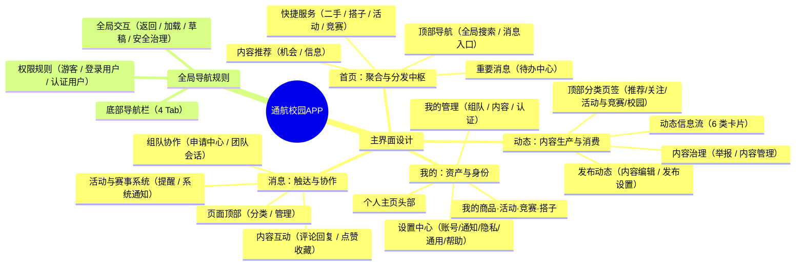
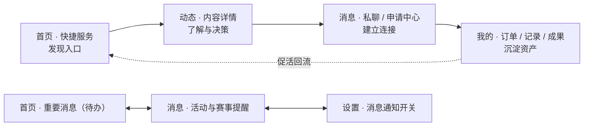

# 通航校园APP 项目总结文档

> 文档性质：对工作区既有资料（`01-调研总结文档.md`、`02-功能脑图.md`、`03-意见与建议文档.md`、`通航校园APP架构设计.xmind`）的整体梳理与提炼。
> 编制说明：本文**不引入原始资料之外的新功能**，仅做结构化归纳与关系梳理；凡属推断或资料未闭环之处，均在文中显式标注。

---

## 一、项目背景

### 1.1 业务背景

「通航校园APP」是一套面向**通用航空类院校**的校园综合服务平台，以小程序/APP 形态承载学生日常的四类核心校园场景——**二手交易、找搭子、活动、竞赛**。

### 1.2 问题起点：校园信息碎片化

调研文档（`01-调研总结文档.md`，调研时间 2026-09）明确指出，**"解决信息碎片化"是所有同类产品的共同出发点**：

- 二手交易信息散落在 QQ 群、微信群、贴吧，重复刷屏、无信用、易纠纷；
- 找搭子依赖熟人介绍或群内"喊人"，匹配效率低、缺少安全设计；
- 活动/竞赛信息发布渠道分散，**报名截止、初赛、答辩等关键节点靠学生自己盯**，漏报率高；
- 缺少统一的内容治理与信任机制，广告、诈骗、侵权内容难以处置。

### 1.3 调研支撑：9 类参考产品

调研覆盖四个赛道共 9 个代表性项目，为本项目提供了直接可借鉴的机制样本：

| 赛道 | 参考项目 | 核心借鉴点 |
|---|---|---|
| 二手交易 | 广州应用科技学院案例、校淘、易果校园二手商城 | 25 页完整交易闭环、担保交易/资金托管、季节性专场、求购反向推送 |
| 找搭子 | 多款搭子小程序、郑软时空 | 兴趣标签匹配、LBS 同校限定、匹配度百分比、女性专属模式 |
| 活动与竞赛 | 校园竞赛信息管理、WeRace、到梦空间 | 关键节点智能提醒、多级报名、签到防代签、名单导出、经验沉淀 |
| 综合平台 | 超级课程表、到梦空间 | 以高频刚需为锚点、本校为社交边界、成长档案、桌面级轻触达 |

### 1.4 定位判断

综合调研与建议文档，项目定位可概括为：

> **以"本校"为信任边界、以"逛 → 发 → 联"为主干路径的校园综合服务平台**，用高频的信息聚合与提醒带动交易、组队、活动、竞赛四类业务，并通过认证与治理体系构建长期信任资产。

---

## 二、核心目标

### 2.1 总目标

把散落于各社交群的校园信息**集中化、结构化**，在单一产品内形成"**浏览 → 发布 → 连接（交易/组队/报名）**"的完整闭环。

### 2.2 分项目标

| 目标 | 说明 | 对应功能落点 |
|---|---|---|
| **信息聚合与分发** | 分类 + 多维筛选 + 个性化推荐，解决"找不到" | 首页快捷服务、内容推荐、动态信息流 |
| **业务闭环** | 交易、搭子、活动、竞赛四类场景各自可独立走通 | 快捷服务四区 + 动态内容 + 消息协作 + 我的记录 |
| **信任与治理** | 认证分级、内容审核、举报与屏蔽，缺一不可 | 权限规则、内容治理、安全治理、系统通知 |
| **关键节点触达** | 截止日期提醒是调研中验证的最高频刚需 | 首页重要消息、消息页活动与赛事提醒 |
| **个人资产沉淀** | 参与记录转化为可展示资产，提升留存 | 我的管理、参赛记录、成果展示 |

### 2.3 实施原则（来自 `03-意见与建议文档.md`）

1. **先跑通"逛 → 发 → 联"闭环，再叠加信任与治理体系。**
2. **顺序比全面重要**：登录 → 交易闭环 → 信息流 → 通知 → 认证权限 → 推荐 → 治理完善，每一步都让上一步的体验成立。
3. **借鉴要抄机制，不要抄功能清单**：面交双向确认、截止提醒、专业冷启动推荐，是投入产出比最高的三个"抄作业"点。
4. **把治理当功能做**：举报按钮、审核队列、封禁管理是校园产品能否活下去的 **P0 能力**，不是后台杂活。
5. **校园产品的天花板是信任，不是功能数量**——宁可砍功能，不可砍治理。

---

## 三、产品总体架构

### 3.1 架构全貌

从 `通航校园APP架构设计.xmind` 看，产品架构由**两大维度**构成，共 **403 个节点、最大 7 层**：

| 维度 | 构成 | 作用 |
|---|---|---|
| **主界面设计** | 首页 / 动态 / 消息 / 我的（4 个 Tab） | 定义用户可见的信息架构与操作入口 |
| **全局导航规则** | 底部导航栏 / 权限规则 / 全局交互 | 定义贯穿全站的导航、权限与交互底座 |

### 3.2 一图看懂架构

### 3.3 架构的三条主线

1. **业务主线（横向）**：商品、搭子、活动、竞赛四类业务对象，横向贯穿全部 4 个 Tab。
2. **场景主线（纵向）**：每个 Tab 承担一种明确的用户心智——首页"找"、动态"聊"、消息"办"、我的"管"。
3. **规则主线（底层）**：权限分级与治理能力作为底座，贯穿所有 Tab 的所有写操作。

---

## 四、四大功能模块详解

### 4.1 首页 —— 聚合与分发中枢

首页承载"**找得到、不错过**"的核心诉求，由四个区块自下而上堆叠：

| 区块 | 内容 | 关键要点 |
|---|---|---|
| **顶部导航** | 全局搜索、消息入口 | 搜索覆盖动态/帖子/重要消息/校园话题，含**搜索历史（单条删除 + 一键清空）**；消息入口带未读状态并可定位未读项 |
| **快捷服务** | 二手服务区、搭子服务区、活动服务区、竞赛服务区 | 四大业务并列入口，采用**"主列表 + 我的（发布/关注/收藏/参与/订单）"**的四段式结构 |
| **重要消息** | 活动/商品/服务等待办、协作待办 | 分为"**即将截止**""**报名开始**""**规则更新**"；协作待办含待处理申请、邀请链接、待完善资料 |
| **内容推荐** | 机会推荐、信息推荐 | 机会推荐按专业/喜好/收藏/浏览记录；信息推荐含官方通知、规则更新、平台公告 |

**关键要点**：快捷服务的每一项都提供"我的视图"（我的商品 / 我发布的 / 我收藏的 / 我的订单…），使首页同时具备"发现"与"回访"双重职能；**竞赛服务区独有"竞赛日程"**，以日历形式呈现报名、初赛、决赛与截止日期。

### 4.2 动态 —— 内容生产与消费

| 子模块 | 内容 | 关键要点 |
|---|---|---|
| **顶部分类页签** | 推荐、关注、活动与竞赛、校园 | 推荐优先展示**可报名/可申请**的内容；校园频道聚合二手、搭子、活动、交友、游戏、社团、竞赛 |
| **动态信息流** | 动态卡片、二手商品内容、找搭子内容、个人内容、活动与竞赛内容 | 卡片结构统一为**发布者信息 + 正文 + 互动数据 + 卡片操作（含举报/不感兴趣）** |
| **发布动态** | 内容编辑、发布设置 | 内容编辑含文字（草稿自动保存）、图片（多图预览排序）、话题、关联内容；发布设置含**可见范围（时间/地域/隐私）**与**评论权限** |
| **内容治理** | 举报、内容管理 | 举报含原因与材料；内容管理含"不感兴趣"与"屏蔽用户" |

**个人内容**是该模块的特色类型，包含三类：**经验分享**（报名、比赛、答辩、作品制作）、**学习记录（打卡）**（课程、技能、阶段进展）、**组队需求**（求招、缺人、技能、联系方式）。

**活动与竞赛内容**进一步细分：竞赛侧含**获奖信息、备赛过程、比赛复盘、项目展示**；活动侧含**校园活动、学术讲座、学术调研**——形成"过程可沉淀、成果可展示"的知识型内容流。

### 4.3 消息 —— 触达与协作

消息页是"**办事的地方**"，按四个层面组织：

| 子模块 | 内容 | 关键要点 |
|---|---|---|
| **页面顶部** | 消息分类、管理操作 | 分为"全部/未读"与**活动、竞赛、商品、搭子、系统五类入口**；支持全部已读与消息设置 |
| **组队协作** | 申请中心、团队会话 | **申请中心**是核心闭环：收到的申请（含技能/简介/学校/理由）→ 同意/拒绝/补充询问 → 我的申请（待处理/已通过/已拒绝/已撤回）；**团队会话**含私聊、队伍群聊、队伍通知（成员加入/退出/角色调整） |
| **内容互动** | 评论与回复、点赞与收藏 | 评论、回复、提及通知；点赞汇总、收藏反馈、新增关注 |
| **活动与赛事系统** | 活动与赛事提醒、系统通知 | 提醒含**报名开始、即将截止（剩余时间）、赛程与活动提醒、规则变化（含官方来源）**；系统通知含内容审核结果、举报处理进度、账号安全、平台公告 |

**关键要点**：这是四类业务（商品/搭子/活动/竞赛）与用户之间唯一的**双向通道**——既接收业务提醒，也承接申请审批与队伍沟通。私聊支持关联活动/竞赛/商品卡片，实现"从沟通直接跳回业务"。

### 4.4 我的 —— 资产与身份

| 子模块 | 内容 | 关键要点 |
|---|---|---|
| **个人主页头部** | 个人资料卡、右上角设置图标 | 资料卡分三层：**基础信息**（头像/昵称/学校）、**能力信息**（专业/技能标签/爱好/性格）、**数据概览**（参与活动比赛数、发帖数）；右上角设置入口带**安全风险提示标记** |
| **我的商品、活动、竞赛、搭子** | 商品、活动、竞赛 | 商品止于**订单信息**（交易时间/金额/联系方式）；活动与竞赛均区分**"进行中"与"历史"**，并在竞赛下设**成果展示**（获奖记录 + 作品资料） |
| **我的管理** | 组队管理、内容管理、个人信息与功能认证 | 组队管理含我的申请/我的队伍/我的招募/收到的邀请；内容管理含我的动态/帖子/评论/收藏；认证含**四种状态**（未认证/认证中/已认证/未通过）与认证页面占位 |
| **设置中心** | 账号管理、消息通知、隐私设置、通用设置、帮助与反馈、退出登录 | 详见下方要点 |

**关键要点**：

- **认证设计刻意收敛**：原文明确"**不涉及学信网材料输入、授权和审核流程**"，仅保留状态读取与权限判断字段——即**认证页面占位 + 接口预留**，为后续接入留出空间。
- **消息通知开关颗粒度细**：组队、活动与比赛、商品、搭子、互动五类均可分别控制；**系统通知（安全与必要服务）不可完全关闭**。
- **隐私设置完整**：资料可见范围、动态可见范围、联系权限（谁能私聊/邀请组队/申请加入）、黑名单、个性化推荐开关。

---

## 五、全局规则

### 5.1 底部导航栏

四个 Tab 各有明确"入口"定位：**首页 = 默认入口**（待办 + 机会推荐）、**动态 = 内容入口**（浏览与发布）、**消息 = 未读角标与组队处理**、**我的 = 个人入口**（管理内容/活动/商品）。

### 5.2 权限规则（三级）

| 角色 | 能力 | 边界 |
|---|---|---|
| **游客** | 仅浏览相关内容 | **不能进行任何操作** |
| **登录用户** | 收藏订阅、管理个人资料 | **不能发布活动/竞赛、不能组队** |
| **认证用户** | 可发布活动与竞赛、可组队 | 对应组织者能力（申请审核、队伍管理） |

> 与 `03-意见与建议文档.md` 呼应：权限必须**服务端双重校验**，前端隐藏入口不够。

### 5.3 全局交互

| 维度 | 规则 |
|---|---|
| **返回规则** | 返回上级页面时**保留列表位置和筛选条件** |
| **加载状态** | 显示加载、空状态、失败重试和离线提示 |
| **发布草稿** | 页面退出**自动保存**未发布内容 |
| **安全治理** | 所有用户内容均提供**举报、屏蔽和申诉**入口 |

---

## 六、模块间关系与关键要点

### 6.1 四类业务对象 × 4 个 Tab 的落点矩阵

这是理解本项目"相互关系"最关键的一张表——**同一业务对象在四个 Tab 中各有分工**：

| 业务对象 | 首页（找） | 动态（聊） | 消息（办） | 我的（管） |
|---|---|---|---|---|
| **商品** | 二手服务区（二手商品/我的商品/我的关注/我的订单） | 二手商品内容（商品信息 + 五面展示图） | 商品分类消息、商品通知（卖出中/已卖出）、私聊商品卡片 | 订单信息、我的收藏、商品通知设置 |
| **搭子** | 搭子服务区（滴搭子帖子/我发布的/我收藏的/我滴过的） | 找搭子内容（性别/爱好/内容/年龄/性格） | 搭子分类消息、搭子通知（寻找中/已找到）、私聊 | 组队管理（我的申请/队伍/招募/邀请）、搭子通知设置 |
| **活动** | 活动服务区、重要消息（报名开始/即将截止） | "活动与竞赛"页签、活动内容（校园活动/学术讲座/学术调研） | 活动分类消息、报名开始/即将截止/赛程提醒、申请中心 | 活动记录（进行中/历史）、我的收藏 |
| **竞赛** | 竞赛服务区（找竞赛/竞赛日程/我的收藏） | "活动与竞赛"页签、竞赛内容（获奖/备赛/复盘/项目展示） | 竞赛分类消息、赛事提醒、队伍群聊 | 参赛记录 + 成果展示（获奖记录/作品资料） |

### 6.2 四条核心业务链路

| 链路 | 路径 | 说明 |
|---|---|---|
| **交易闭环** | 首页二手服务区 → 商品详情 → 私聊沟通 → 订单信息 | 商品发布后进入动态商品内容，成交后沉淀为订单 |
| **组队闭环** | 首页活动/竞赛 → 详情与报名 → 申请中心审批 → 队伍群聊 | 覆盖"发布招募—申请—审批—协作—成果"全周期 |
| **内容闭环** | 动态发布 → 内容治理（审核）→ 系统通知结果 → 我的内容管理 | 举报/不感兴趣/屏蔽构成消费侧治理 |
| **提醒闭环** | 首页待办 ↔ 消息提醒 ↔ 设置开关 | 即将截止、报名开始、规则变化三处同源，避免漏报 |

### 6.3 关键设计要点

1. **待办中心化**：首页"重要消息"把"即将截止 / 报名开始 / 规则更新"和协作待办前置到首页，直接回应调研中"截止提醒是刚需中的刚需"。
2. **竞赛日程日历化**：以日历视图查看报名、初赛、决赛、截止日期，是时间管理型业务的差异化设计。
3. **申请中心 + 队伍群聊**：把"组队"从一次性匹配升级为可持续协作，配合"我的招募/我的队伍/收到的邀请"形成完整管理面。
4. **成果可沉淀**：竞赛下设"获奖记录 + 作品资料"，活动现场有"学术讲座/学术调研"，把参与行为转化为可展示的个人资产。
5. **草稿与容错**：发布类页面统一"退出自动保存"，返回保留列表位置与筛选条件——从交互层降低流失。
6. **治理前置**：举报、屏蔽、申诉入口覆盖所有用户内容，且与系统通知中的"举报处理/内容审核"结果形成闭环。
7. **认证边界清晰**：认证页面只做占位与接口预留，明确不涉及学信网材料与审核流程，降低合规与实现风险。

### 6.4 资料中的待完善点（供决策参考）

以下为整理过程中发现的、**原始资料尚未闭环或存在不一致**之处，未擅自补全，列出以便后续确认：

| # | 位置 | 现象 | 建议 |
|---|---|---|---|
| 1 | 我的 › 4.2 节点标题 | 标题为"我的商品、活动、**竞赛、搭子**"，但其下仅展开了商品、活动、竞赛三类，**缺"搭子"子节点** | 补齐"我的搭子"子结构，或调整标题 |
| 2 | 全局导航 › 底部导航栏 | "消息"Tab 的定位标签写作"**写作入口**"，与实际承载的未读消息与组队协作不匹配（疑为"消息/协作入口"之误） | 确认后统一文案 |
| 3 | 我的 · 认证 | 认证状态定义了四态（未认证/认证中/已认证/未通过），但**未定义各状态下可用的具体功能范围** | 与权限规则（游客/登录用户/认证用户）做映射表 |
| 4 | 商品订单 | 仅"订单信息（交易时间/金额/联系方式）"，**无订单状态流转定义** | 参考调研补充状态机：已下单 → 待面交 → 已完成 → 已评价 |
| 5 | 全局交互 · 加载状态 | 仅概括为"加载/空状态/失败重试/离线提示"，**未细化各页面的空状态引导** | 补充关键页面的空状态与首屏骨架屏规范 |

---

## 七、实施路径与风险应对

### 7.1 优先级规划（来自 `03-意见与建议文档.md`）

| 阶段 | 目标 | 主要内容 |
|---|---|---|
| **P0 · MVP（4~6 周）** | 产品成立 | 登录体系（微信一键 + 游客模式）、四页骨架、首页快捷服务 + 搜索、二手交易闭环、动态发布与信息流、基础消息通知、权限硬控制（服务端校验） |
| **P1（+3~4 周）** | 产品好用 | 学号认证流程、收藏 + 浏览历史 + 专业偏好推荐、找搭子（标签匹配 + 同校 + 匹配度）、截止日期自动提醒、草稿自动保存、举报入口与后台工单 |
| **P2** | 决定留存 | 信用分与双向评价、组织者管理后台（报名审核/签到/名单导出）、搭子组局管理（人数上限/AA 账单/群聊）、担保交易与资金托管、深色模式与桌面小组件 |
| **P3 · 暂缓** | 观察 | 音视频与直播、会员付费、校际互通、AI 智能定价/摘要 |

### 7.2 关键取舍

- **混合信息流**首版简化，先做动态/商品/活动竞赛三类卡片；
- **担保交易/资金托管**首版不做，先以"面交双向确认"覆盖 80% 以上校园场景；
- **即时通讯不自研**，直接采用微信小程序客服消息或腾讯云 IM SDK；
- **内容审核**以机审为主、疑似违规抽样人审，而非全量先审后发；
- **女性专属搭子模式保留**（低成本、差异化强）；
- **第二课堂成绩单式成长档案**远期观察（依赖校方合作），先做简单"参与记录"。

### 7.3 主要风险与应对

| 风险 | 应对措施 |
|---|---|
| **合规与审核**（最高优先级） | 教育移动应用备案；敏感词库 + 内容安全 API + 举报 24h SLA；首版明确"平台仅提供信息撮合"的用户协议 |
| **冷启动**（最高失败率） | 单校试点起步；自铺 200~500 条种子内容；以**竞赛信息聚合**为最佳抓手（官方来源、无需 UGC、刚需高频） |
| **技术** | 办活动/竞赛权限服务端双重校验；首版推荐权重建议 `专业匹配 40% + 热度 40% + 新鲜度 20%`；关键通知设计重试与多通道兜底 |
| **运营** | 开学季/毕业季做"毕业清仓""新生好物"专题；组织者引入信用押金分或审核制准入，活动前 24h 未响应自动降权 |

---

## 八、资料索引

| 文件 | 内容 |
|---|---|
| `01-调研总结文档.md` | 9 类参考产品调研、六大共性功能、各赛道亮点、交互设计共性、可借鉴要点 |
| `02-功能脑图.md` | 以 Mermaid 描述的早期功能脑图及补充规则（权限、冷启动、草稿、内容治理） |
| `03-意见与建议文档.md` | 功能优先级（P0~P3）、功能取舍、四类风险与应对、给开发者的三条总结 |
| `04-思维导图（重构版）.md` | **本次重构**：基于 XMind 源文件（403 节点 / 7 层）逐节点还原的结构化思维导图 + Mermaid 源码 + 勘误附录 |
| `通航校园APP架构设计.xmind` | 架构设计原始思维导图（本总结的结构来源） |
| `通航校园APP架构设计.png` | 上述思维导图的导出版图片 |

---

## 九、结论

「通航校园APP」的架构设计已经完成了**从"调研借鉴"到"信息架构落地"**的关键跨越：以 4 个 Tab 承载"找、聊、办、管"四种用户心智，以商品/搭子/活动/竞赛四类业务对象横向贯穿，以三级权限与举报治理体系作为底座。

其设计的**最强项**在于抓住了调研验证过的两个高价值机制——**关键节点提醒（首页待办 + 消息提醒双保险）**与**组队协作闭环（申请中心 + 队伍群聊）**；其**最需补强**之处在于**权限与认证状态的映射细化**、**订单状态流转定义**，以及**页面级空状态规范**（见 6.4 节）。

按 `03-意见与建议文档.md` 的实施顺序推进——**先闭环、后治理、再推荐**——即可在控制范围的同时，保持产品可用性与信任基础同步建立。
