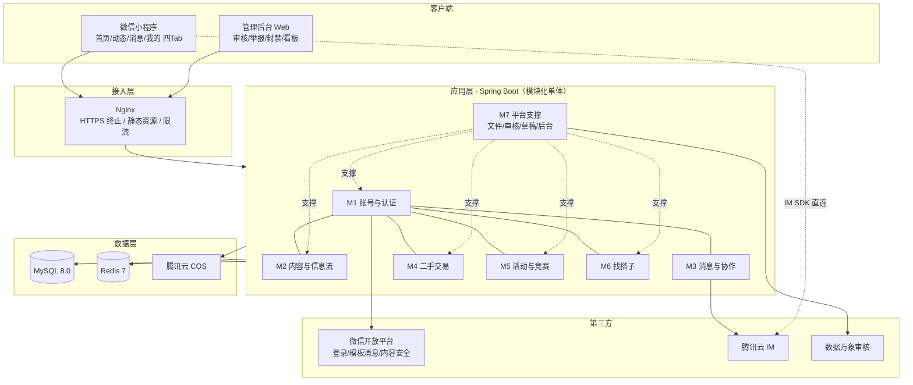

# 11 · 系统概要设计文档

> **文档编号**：11 ｜ **版本**：v1.0 ｜ **日期**：2026-09-29 ｜ **状态**：评审稿
> **上游**：《10-需求文档》 ｜ **下游**：《12-数据库设计》《13-API接口文档》《14-开发计划》《19-团队分工与联调方案》
> **结构基线**：《04-思维导图（重构版）》（主界面设计 + 全局导航规则）

---

## 1. 总体架构

### 1.1 架构风格决策

| 决策点 | 结论 | 理由 |
|---|---|---|
| 终端形态 | **首发微信小程序**（原生框架），二期评估 uni-app 出 APP | 调研案例全部为小程序；微信一键登录 + 模板消息生态成熟；单校试点获客成本低 |
| 后端架构 | **Spring Boot 3.2 模块化单体**（按 M1~M7 分包），不引入微服务 | 10 人团队、单校规模；模块化单体保留后续拆分能力，运维成本低 |
| IM | **腾讯云 IM（TIM）**，不自研 | 《03》明确不建议自研 IM；群聊、云端留存开箱即用 |
| 文件与审核 | 腾讯云 COS + 数据万象内容审核 | 图文审核合规兜底，敏感词库本地 DFA 双保险 |
| 数据 | MySQL 8.0（主存储）+ Redis 7（缓存/会话/频控/热榜） | 简单可靠；全文检索用 MySQL ngram，v1.x 可平滑替换为 ES |

### 1.2 架构图



### 1.3 逻辑分层

| 层 | 职责 | 说明 |
|---|---|---|
| 接入层 | HTTPS、限流、静态资源 | 单实例 Nginx，keepalived 预留 |
| Controller | 参数校验、登录态/权限注解、统一响应 | 统一 `Result<T>`，错误码见《13》§2.4 |
| Service | 业务规则、状态机、事务边界 | 模块间调用只经 Service 接口，禁止跨模块访问 Mapper |
| 基础设施 | 缓存、MQ 事件（Spring 事件总线）、定时任务 | 截止提醒用 `@Scheduled` 扫描 + Redis 分布式锁防重 |
| Mapper | MyBatis-Plus，仅本模块可访问 | 表归属见《12》§1.3 |

---

## 2. 模块划分与职责

模块编号与《10-需求文档》§4 严格一致：

| 模块 | 职责边界 | 关键类（示意） | 负责人（见《19》） |
|---|---|---|---|
| **M1 账号与认证** | 登录/游客态、Token 签发续期、学号认证四态、权限判定、注销 | `AuthService` `VerifyService` `PermissionChecker` | BE-D |
| **M2 内容与信息流** | 动态发布/信息流聚合/评论点赞收藏/搜索/推荐画像/话题/敏感词机审 | `FeedService` `PostService` `SearchService` `RecommendService` `SensitiveFilter` | BE-E |
| **M3 消息与协作** | 通知中心（六类）、待办计算、组队申请中心、TIM 后端集成、提醒定时任务 | `NotifyService` `TodoService` `TeamApplyService` `ReminderJob` | BE-F |
| **M4 二手交易** | 商品发布浏览、订单状态机、面交双向确认、求购反向推送、评价信用 | `GoodsService` `OrderService` `CreditService` | BE-G |
| **M5 活动与竞赛** | 发布报名审核、日历日程、名单管理、成果沉淀、规则变化提醒 | `ActivityService` `CompetitionService` `EnrollService` | BE-G |
| **M6 找搭子** | 搭子帖、标签筛选、匹配交互、女性模式、组局 | `BuddyService` `MatchService` | BE-G |
| **M7 平台支撑** | 文件上传审核、草稿、官方通知、系统配置、举报工单、管理后台、审计 | `FileService` `DraftService` `ReportService` `AdminService` | BE-D |

### 2.1 模块依赖规则

```
M1（账号权限） ← 被 M2~M6 依赖（所有写操作经 PermissionChecker）
M7（支撑） ← 被 M2~M6 依赖（文件、草稿、举报）
M3（消息） ← 被 M2/M4/M5/M6 调用发通知（NotifyService.send，仅接口依赖）
M4/M5/M6 之间禁止横向互调（无直接依赖；如需联动经 M3 发通知）
```

前端分包镜像模块结构：`pages/home`（FE-A）、`pages/feed + publish`（FE-B）、`pages/message + pages/me`（FE-C），公共层 `framework/`（FE-A 维护）。

---

## 3. 关键设计

### 3.1 权限模型（三层判定）

```
登录态拦截（HandlerInterceptor）
  → 无 Token：读接口放行（游客），写接口 40001
角色判定（PermissionChecker，AOP 注解 @RequireRole）
  → @RequireRole(USER)：登录即可（发布动态/商品/搭子、报名、申请组队）
  → @RequireRole(VERIFIED)：需学号认证（发布活动/竞赛、管理报名）
业务校验（Service 内）
  → 资源归属（编辑/删除仅限本人）、状态机合法性（见各域）
```

认证用户发布内容 `weight_boost = 1.5`（信息流加权曝光）。

### 3.2 信息流聚合设计

首页/动态页混合信息流不建立大宽表，采用**运行时聚合 + Redis 缓存**：

1. 各业务表（post/goods/buddy_post/activity/competition）写入时投递内容事件；
2. Feed 服务按 Tab（推荐/关注/活动与竞赛/校园）拉取候选 `content_type + content_id` 列表（Redis ZSet 缓存 5 分钟）；
3. 批量回表补全卡片字段，过滤：可见范围、屏蔽关系、未通过审核；
4. 推荐排序：`score = 专业匹配×0.4 + 热度×0.4 + 新鲜度×0.2`（详见《10》FR-M2-08）。

> 取舍说明：单校数据量（<10 万帖）聚合查询可控，避免宽表一致性维护成本；v1.x 若超出容量再演进为推模式。

### 3.3 订单状态机（M4 核心）

```
[创建] 买家下单（待卖家确认，付款前置：双方可见联系方式仅在卖家确认后）
  ├─ 卖家确认 → 待面交
  │    ├─ 买家确认 + 卖家确认（任一方先发起，另一方确认）→ 已完成
  │    └─ 72h 无双方确认 → 自动关闭
  ├─ 卖家拒绝 / 30分钟买家未付款 → 已取消
  └─ 任一方在"待面交"前可取消
完成后 → 互评（P2）→ 信用分更新
```

### 3.4 提醒体系（M3 核心，NFR-12）

| 提醒 | 触发 | 通道 | 兜底 |
|---|---|---|---|
| 竞赛/活动即将截止 | 定时任务每日 09:00/21:00 扫描 deadline 前 7/3/1 天 | 站内通知 | 模板消息（T-1 晚） |
| 报名开始 | 定时任务扫描 enroll_start 到达 | 站内 + 模板消息 | — |
| 规则变化 | 竞赛/活动内容更新 diff | 站内通知 | — |
| 申请/邀请/组队 | 业务事件实时投递 | 站内 + TIM | — |

所有提醒生成统一入 `notify_message`，频控在 Redis（单用户单业务 5 条/小时），去重键 `user+biz+content+date`。

### 3.5 草稿与容错

- 五类发布页统一走 `DraftService`，前端节流（2s）保存 JSON 到本地 + 服务端双写；
- 返回保留列表位置：前端 `onUnload` 缓存 scrollOffset + 筛选条件于 storage，返回恢复；
- 敏感内容退出前拦截提醒（命中未提交时弹确认）。

### 3.6 内容治理流水线

```
发布 → 一级敏感词（DFA 拦截，40008）
     → 二级敏感词/图片审核（数据万象，同步接口）
     → 疑似违规 → 人工复审队列（后台）
     → 举报（ReportService）→ 24h SLA 工单 → 处罚（下架/禁言/封禁）→ 双方通知
     → 申诉 → 复议流程（管理员二审）
```

审计日志（audit_log）记录一切管理端操作。

---

## 4. 工程结构

### 4.1 后端（campus-server）

```
campus-server/
├── campus-common/          # 统一响应/异常/工具/错误码
├── campus-module-account/  # M1 + M7 草稿/文件/配置
├── campus-module-content/  # M2
├── campus-module-message/  # M3
├── campus-module-trade/    # M4
├── campus-module-event/    # M5 + M6
└── campus-admin/           # 管理后台接口（M7）
```

### 4.2 前端（campus-miniapp）

```
campus-miniapp/
├── framework/     # 请求封装/权限路由/全局组件（列表卡片/空态/骨架屏）—— FE-A
├── pages/home/    # 首页四区块 —— FE-A
├── pages/feed/    # 动态页签+信息流 —— FE-B
├── pages/publish/ # 发布中心 —— FE-B
├── pages/message/ # 消息+申请中心 —— FE-C
├── pages/me/      # 我的+设置 —— FE-C
└── components/    # 业务卡片（按 content_type 注册）
```

### 4.3 关键技术约定

| 项 | 约定 |
|---|---|
| 接口契约 | Apifox 维护，字段 camelCase，时间 ISO8601+08:00，见《13》 |
| 错误码 | 全局唯一枚举 `ErrorCode`（common 包），新增需 BE-D 评审 |
| 分支策略 | `main`（可发布）/ `dev` / `feature/<module>-<task>`，PR 必须关联任务号 |
| 环境配置 | dev / test / prod 三套 profile，密钥走环境变量，不入库 |

---

## 5. 纵切面设计

### 5.1 安全

HTTPS 全链路；Token = JWT（2h）+ Refresh（7d）；手机号/姓名 AES 加密落库、展示脱敏；上传文件白名单 + 类型嗅探；接口级频控（Redis 令牌桶，登录 10 次/分钟、发布 5 次/分钟）。

### 5.2 性能

列表类接口 Redis 缓存 + 分页（默认 20）；热门内容热榜 ZSet；图片走 CDN 管道（数据万象压缩）。压测验收见《15-测试用例》性能用例组。

### 5.3 可观测

统一访问日志（含 userId/traceId）；关键业务埋点（发布成功率、订单转化、提醒到达）；Nginx + Spring Actuator 健康检查，Prometheus + Grafana 监控（部署见《16》§6）。

---

## 6. 设计决策记录（ADR 摘要）

| # | 决策 | 备选 | 结论 |
|---|---|---|---|
| ADR-1 | 模块化单体 vs 微服务 | 微服务 | 单体，按模块分包隔离 |
| ADR-2 | 信息流拉模式聚合 vs 宽表 | 宽表 | 拉模式+缓存，容量可控 |
| ADR-3 | IM 自研 vs 三方 | 自研 | 腾讯云 IM（《03》取舍） |
| ADR-4 | 支付/托管 | 面交双向确认 | v1 不接资金流，协议明示"仅信息撮合" |
| ADR-5 | 全文检索 | ES | MySQL ngram 起步，预留 ES 接口 |
