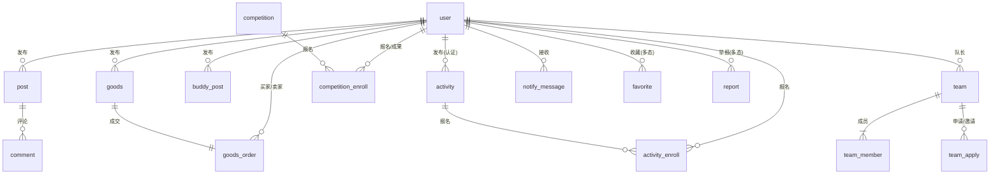

# 12 · 数据库设计文档

> **文档编号**：12 ｜ **版本**：v1.0 ｜ **日期**：2026-09-29 ｜ **状态**：评审稿
> **上游**：《10-需求文档》《11-系统概要设计》 ｜ **下游**：《13-API接口文档》各接口字段、后端实体类
> **约定**：MySQL 8.0 / InnoDB / utf8mb4；主键 `id BIGINT UNSIGNED AUTO_INCREMENT`；时间字段 `DATETIME`（UTC+8）；软删除用 `deleted_at`（仅内容类表）；金额 `DECIMAL(10,2)`。下表仅列业务字段，通用审计字段（`created_at` / `updated_at`）所有表默认携带，不再重复。

---

## 1. 总览

### 1.1 表域划分（30 张）

| 域 | 表 | 归属模块 / 负责人（见《19》） |
|---|---|---|
| 用户域 | `user` `user_credential` `user_verify_apply` `follow` `blacklist` | M1 / BE-D |
| 内容域 | `topic` `post` `post_topic_rel` `comment` `like_record` `favorite` `browse_history` `sensitive_word` | M2 / BE-E |
| 协作域 | `notify_message` `team` `team_member` `team_apply` `official_notice` | M3 / BE-F |
| 交易域 | `goods` `goods_order` `goods_wanted`(求购) `credit_log` | M4 / BE-G |
| 活动竞赛域 | `activity` `activity_enroll` `competition` `competition_enroll` | M5 / BE-G |
| 搭子域 | `buddy_post` | M6 / BE-G |
| 支撑域 | `report` `draft` `file_object` `feedback` `sys_config` `audit_log` | M7 / BE-D |

### 1.2 核心关系图

### 1.3 通用多态字段

`target_type` / `biz_type` 枚举全局统一：

| 类型值 | 含义 |
|---|---|
| 1 动态 `post` ／ 2 商品 `goods` ／ 3 活动 `activity` ／ 4 竞赛 `competition` ／ 5 搭子帖 `buddy_post` ／ 6 评论 `comment` ／ 7 求购帖 ／ 8 官方通知 `official_notice` |

---

## 2. 表结构定义

### 2.1 用户域（M1 / BE-D）

**`user` 用户主表**

| 字段 | 类型 | 说明 |
|---|---|---|
| id | BIGINT | 主键 |
| nickname | VARCHAR(32) | 昵称 |
| avatar_url | VARCHAR(512) | 头像（COS 地址） |
| gender | TINYINT | 0 未知 1 男 2 女 |
| school_id | BIGINT | 试点学校固定为 1（预留多校） |
| major | VARCHAR(64) | 专业（推荐画像种子） |
| grade | VARCHAR(16) | 年级，如 2024 级 |
| bio | VARCHAR(200) | 简介 |
| skill_tags | JSON | 技能标签（申请中心展示） |
| hobby_tags | JSON | 爱好标签（搭子匹配） |
| personality | VARCHAR(64) | 性格标签 |
| user_type | TINYINT | 1 普通用户 2 认证用户 |
| verify_status | TINYINT | 0 未认证 1 认证中 2 已认证 3 未通过 |
| credit_score | INT | 信用分，默认 100 |
| status | TINYINT | 0 正常 1 禁言 2 封禁 |
| deleted_at | DATETIME | 软删（注销） |

索引：`idx_school_major(school_id, major)`；`idx_verify(verify_status)`

**`user_credential` 登录凭证**

| 字段 | 类型 | 说明 |
|---|---|---|
| user_id | BIGINT | 关联 user |
| cred_type | TINYINT | 1 微信 openid 2 手机号 3 邮箱 |
| identifier | VARCHAR(128) | 凭证（手机号/邮箱 AES 加密） |
| verified | TINYINT | 是否已验证（微信默认 1） |

索引：唯一 `uk_type_ident(cred_type, identifier)`；`idx_user(user_id)`

**`user_verify_apply` 学号认证申请**

| 字段 | 类型 | 说明 |
|---|---|---|
| user_id | BIGINT | 申请人 |
| student_no | VARCHAR(32) | 学号 |
| real_name | VARCHAR(64) | 姓名（AES 加密） |
| campus_card_file_id | BIGINT | 校园卡照片（file_object.id） |
| status | TINYINT | 0 待审核 1 通过 2 驳回 |
| reject_reason | VARCHAR(200) | 驳回原因（认证四态展示） |
| reviewed_by | BIGINT | 审核管理员 |
| reviewed_at | DATETIME | 审核时间 |

索引：`idx_user_status(user_id, status)`

**`follow` 关注**（target_type 1 用户 / 9 话题）

唯一索引 `uk_follow(follower_id, target_type, target_id)`

**`blacklist` 屏蔽黑名单**：唯一索引 `uk_blk(user_id, blocked_user_id)`。屏蔽为双向过滤：内容、私信、申请均不可达。

### 2.2 内容域（M2 / BE-E）

**`post` 动态**（类型：1 图文 2 经验分享 3 学习打卡 4 组队需求）

| 字段 | 类型 | 说明 |
|---|---|---|
| user_id | BIGINT | 发布者 |
| post_type | TINYINT | 1~4，见上 |
| content | TEXT | 正文（FULLTEXT ngram） |
| images | JSON | 图片 file_object.id 列表（≤9，单图 ≤10MB） |
| link_type / link_id | TINYINT / BIGINT | 关联内容（活动/竞赛/商品/技能/话题） |
| visible_scope | TINYINT | 0 公开 1 仅关注 2 私密 |
| comment_permission | TINYINT | 0 所有人 1 关注的人 2 仅自己 3 关闭 |
| like_cnt / comment_cnt / favorite_cnt / view_cnt | INT | 冗余计数（Redis 计数 + 定时回写） |
| status | TINYINT | 0 待审 1 已通过 2 已下架 3 审核退回 |
| is_top | TINYINT | 后台置顶 |

索引：`idx_status_time(status, created_at)`；`idx_user(user_id)`；FULLTEXT `ft_content(content)` ngram

**`topic` 话题**：name 唯一；type（1 商品 2 搭子 3 竞赛 4 活动 5 学校 6 技能 7 校园）；use_count。
**`post_topic_rel`**：唯一索引 `uk_pt(post_id, topic_id)`。
**`comment` 评论**：post_id、user_id、parent_id、reply_to_user_id、content、like_cnt、status；索引 `idx_post(post_id, status, created_at)`。
**`like_record` 点赞**（target_type 1 动态 6 评论）：唯一索引 `uk_like(user_id, target_type, target_id)`。
**`favorite` 收藏**（target_type 全枚举见 §1.3）：唯一索引 `uk_fav(user_id, target_type, target_id)`；索引 `idx_target(target_type, target_id)`（反向推送/截止提醒联动）。
**`browse_history` 浏览历史**：user_id、target_type、target_id、viewed_at；索引 `idx_user_time(user_id, viewed_at)`（推荐画像数据源）。
**`sensitive_word` 敏感词**：word、level（1 拦截 2 复审）、status；唯一索引 `uk_word(word)`。

### 2.3 协作域（M3 / BE-F）

**`notify_message` 站内通知**

| 字段 | 类型 | 说明 |
|---|---|---|
| user_id | BIGINT | 接收者 |
| biz_type | TINYINT | 10 交易 20 组队 30 互动 40 系统 50 活动竞赛 60 平台 |
| title / content | VARCHAR(64) / VARCHAR(500) | 展示文案 |
| link_type / link_id | TINYINT / BIGINT | 点击跳转目标 |
| is_read / read_at | TINYINT / DATETIME | 已读状态 |
| dedup_key | VARCHAR(64) | 去重键（提醒类）：user+biz+date |

索引：`idx_user_read(user_id, is_read, created_at)`；唯一 `uk_dedup(dedup_key)`（可空）

**`team` 队伍**：name、leader_id、biz_type（3 活动 / 4 竞赛）、biz_id、quota、announcement、status（0 招募中 1 已满 2 已关闭）；索引 `idx_biz(biz_type, biz_id)`。
**`team_member`**：team_id、user_id、role（0 队长 1 成员）；唯一 `uk_tm(team_id, user_id)`。
**`team_apply` 申请与邀请**（申请中心数据源）

| 字段 | 类型 | 说明 |
|---|---|---|
| team_id | BIGINT | 队伍 |
| user_id | BIGINT | 发起方（direction=1 时为申请人；=2 时为被邀请人） |
| direction | TINYINT | 1 我发出的申请 2 我收到的邀请 |
| message | VARCHAR(200) | 申请理由/邀请说明 |
| skills | JSON | 展示技能 |
| status | TINYINT | 0 待处理 1 已通过 2 已拒绝 3 已撤回 4 补充询问 |

索引：`idx_team_status(team_id, status)`；`idx_user(user_id)`

**`official_notice` 官方通知**：type（1 官方通知 2 规则更新 3 平台公告）、source、title、content、link_url、publish_at、status。

### 2.4 交易域（M4 / BE-G）

**`goods` 二手商品**

| 字段 | 类型 | 说明 |
|---|---|---|
| user_id | BIGINT | 卖家 |
| title | VARCHAR(60) | 标题（FULLTEXT ngram） |
| category_id | BIGINT | 品类（sys_config 字典） |
| price | DECIMAL(10,2) | 现价；orig_price 原价 |
| cond | TINYINT | 成色（1~5） |
| dims | VARCHAR(60) | 尺寸（长宽高） |
| description | VARCHAR(1000) | 简介 |
| images | JSON | 六面展示图（合规：正/侧/背/上/下） |
| status | TINYINT | 0 待审 1 在售 2 已下架 3 已售出 4 已删除 5 审核退回 |
| view_cnt / favorite_cnt | INT | 计数 |

索引：`idx_cat_status_time(category_id, status, created_at)`；`idx_user(user_id)`；FULLTEXT `ft_title(title)`

**`goods_order` 订单（状态机见《11》§3.3）**

| 字段 | 类型 | 说明 |
|---|---|---|
| order_no | VARCHAR(32) | 唯一单号 |
| goods_id | BIGINT | 商品 |
| buyer_id / seller_id | BIGINT | 买卖双方 |
| amount | DECIMAL(10,2) | 成交价 |
| status | TINYINT | 10 待卖家确认 20 待付款 30 待面交 40 待确认(单方) 50 已完成 60 已取消 70 超时关闭 |
| buyer_confirm_at / seller_confirm_at | DATETIME | 面交双向确认时间戳 |
| pay_timeout_at / confirm_deadline | DATETIME | 30min 付款超时 / 72h 确认截止 |
| cancel_reason | VARCHAR(100) | 取消原因 |

索引：唯一 `uk_no(order_no)`；`idx_buyer(buyer_id, status)`；`idx_seller(seller_id, status)`；`idx_deadline(confirm_deadline)`（超时任务扫描）

**`goods_wanted` 求购帖**：user_id、keywords（JSON，反向推送匹配用）、desc、status。
**`credit_log` 信用流水**：user_id、delta、biz_type、biz_id、remark；索引 `idx_user(user_id)`。

### 2.5 活动竞赛域（M5 / BE-G）

**`activity` 活动**

| 字段 | 类型 | 说明 |
|---|---|---|
| publisher_id | BIGINT | 发布者（须认证用户） |
| title / cover / content | — | 基本信息 |
| category | TINYINT | 1 校园活动 2 学术讲座 3 学术调研 |
| place / capacity | VARCHAR(128) / INT | 地点与人数上限 |
| start_at / end_at | DATETIME | 举行时间 |
| enroll_start / enroll_deadline | DATETIME | 报名起止（提醒任务扫描） |
| need_review | TINYINT | 报名是否需审核 |
| status | TINYINT | 0 待审 1 报名中 2 进行中 3 已结束 4 已取消 |

索引：`idx_deadline(enroll_deadline)`；`idx_status_time(status, created_at)`；`idx_publisher(publisher_id)`

**`activity_enroll` 活动报名**：activity_id、user_id、apply_msg、contact、status（0 待审核 1 通过 2 拒绝 3 已签到 4 已取消）；唯一 `uk_ae(activity_id, user_id)`。

**`competition` 竞赛**：publisher_id、title、level（校级/省级/国家级）、organizer、contact、requirement、enroll_start、**enroll_deadline**、preliminary_at、final_at、status；索引 `idx_deadline(enroll_deadline)`、`idx_level(level)`。

**`competition_enroll` 竞赛报名与成果**

| 字段 | 类型 | 说明 |
|---|---|---|
| competition_id / user_id / team_id | BIGINT | 个人或队伍参赛 |
| apply_msg | VARCHAR(500) | 报名信息 |
| status | TINYINT | 0 待审核 1 通过 2 拒绝 3 已取消 |
| result | TINYINT | 0 无 1 一等奖 2 二等奖 3 三等奖 4 优秀奖 5 入围 |
| award_desc | VARCHAR(200) | 获奖说明（成果展示页） |
| work_intro / work_link / work_files | — | 作品资料（项目介绍/演示链接/附件） |

索引：唯一 `uk_ce(competition_id, user_id)`；`idx_team(competition_id, team_id)`

### 2.6 搭子域（M6 / BE-G）

**`buddy_post` 搭子帖**

| 字段 | 类型 | 说明 |
|---|---|---|
| user_id | BIGINT | 发布者 |
| buddy_type | TINYINT | 1 学习 2 运动 3 娱乐 4 旅行 5 饭搭子 6 技能 |
| tags | JSON | 兴趣标签（筛选） |
| desc | VARCHAR(500) | 展示性别/爱好/年龄/性格等 |
| gender_limit | TINYINT | 0 不限 1 仅女性（女性专属模式） |
| quota / fee_mode | INT / TINYINT | 人数上限 / 0 AA 1 请客（P2 组局） |
| matched | TINYINT | 0 寻找中 1 已找到（"我滴过的"） |
| status | TINYINT | 0 待审 1 正常 2 已关闭 |

索引：`idx_type_status(buddy_type, status, created_at)`；`idx_user(user_id)`

### 2.7 支撑域（M7 / BE-D）

**`report` 举报工单**：reporter_id、target_type、target_id、reason_type（1 虚假 2 诈骗 3 侵权 4 违规 5 其他）、desc、evidence（JSON file ids）、status（0 待处理 1 处理中 2 已处理 3 驳回）、handler_id、result、handled_at（24h SLA 统计口径）；索引 `idx_status_time(status, created_at)`。
**`draft` 草稿**：user_id、draft_type（1 动态 2 商品 3 活动 4 竞赛 5 搭子）、payload（JSON）、updated_at；唯一 `uk_draft(user_id, draft_type)`。
**`file_object` 文件**：user_id、biz_type、url、size、mime、audit_status（0 待审 1 通过 2 拦截）、审核失败原因；索引 `idx_user(user_id)`。
**`feedback` 意见反馈**：user_id、type、content、images、contact、status、reply。
**`sys_config` 配置字典**：cfg_key 唯一、cfg_value、remark。品类、成色、专场运营位均配置于此。
**`audit_log` 审计日志**：admin_id、action、target_type、target_id、detail、ip；索引 `idx_admin_time(admin_id, created_at)`。

---

## 3. 数据一致性设计

| 主题 | 方案 |
|---|---|
| 冗余计数 | Redis INCR 实时 + 每分钟回写；展示允许最终一致 |
| 订单/报名状态流转 | 乐观锁 `UPDATE ... WHERE status=<旧值>`，影响行数=0 视为并发冲突（40007） |
| 提醒幂等 | notify_message 唯一去重键 + Redis 锁，防止定时任务重复发送 |
| 面交双向确认 | 两个字段各自 `WHERE IS NULL` 更新，最后一次更新触发状态机迁移 |
| 软删与屏蔽 | 内容查询统一追加过滤：`status=1 AND deleted_at IS NULL AND 作者 NOT IN (黑名单)` |
| 事务边界 | 状态机变更 + 通知写入同事务；IM 推送允许异步补偿失败 |

## 4. 容量与演进

- 试点期预估：user 2 万、post 10 万、goods 5 万、notify_message 300 万/年 → 单实例 MySQL 充足；
- notify_message 按月分区（PARTITION BY RANGE），保留 12 个月；
- 预留演进：browse_history 3 个月归档；全文检索迁 ES（接口已隔离 `SearchService`）；画像迁独立表。

## 5. 变更管理

1. 库表变更走 Flyway 版本脚本（`V<日期>__<说明>.sql`），评审人 BE-D；
2. 任何字段语义变更须同步更新本文档与《13-API接口文档》；
3. 建表评审纳入 M0 里程碑（2026-10-16 前完成）。
