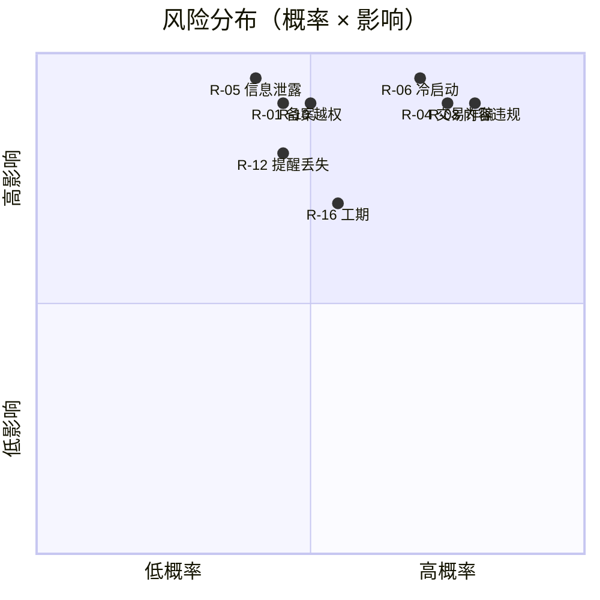

# 18 · 风险评估与隐私合规文档

> **文档编号**：18 ｜ **版本**：v1.0 ｜ **日期**：2026-09-29 ｜ **状态**：评审稿
> **基线**：《03-意见与建议文档》§三 风险与应对（本篇为其工程化扩展）｜ **责任人**：项目经理 J（合规）＋ BE-D（安全）
> **审查机制**：M0~M4 每里程碑复评一次；风险状态变更须在周会同步

---

## 1. 风险登记册

> 概率/影响：高 H、中 M、低 L；等级 = 二者取高；每项含**触发预警指标**与**负责人**。

### 1.1 合规与内容风险（最高优先级）

| 编号 | 风险 | P/I | 应对 | 预警指标 | 负责人 |
|---|---|---|---|---|---|
| R-01 | 教育移动应用备案未完成即上线（监管处罚） | M/H | M0 启动备案流程；提审前未受理则**延期 M4**，不冒险上线（见《14》§6.3） | W10 复查受理状态 | J |
| R-02 | 小程序类目/隐私接口审核驳回 | M/M | 提前 W1 提交类目（T0.6）；驳回即按驳回意见 3 日内整改重提 | 驳回通知 | J |
| R-03 | UGC 违规内容（广告、代写、租房、涉政涉黄） | H/H | 一级敏感词拦截 + 图片审核 API + 人工复审 + **举报 24h SLA**（FR-M7-03/《15》TC-M7-01）；处罚分级公示 | 单日待审积压 > 200 | D |
| R-04 | 私下交易诈骗纠纷 | H/H | 面交双向确认 + 信用分 + 举报仲裁；用户协议**明示"平台仅提供信息撮合"**；防诈提示常驻（《17》§5） | 诈骗类举报占比 > 20% | G/J |
| R-05 | 认证信息（学号/姓名/证件照）泄露 | M/H | AES 加密落库、展示脱敏、COS 私有桶 + 短时效 URL；管理端查看全量审计（《16》§9） | 异常批量查询告警 | D |

### 1.2 冷启动与运营风险

| 编号 | 风险 | P/I | 应对 | 预警指标 | 负责人 |
|---|---|---|---|---|---|
| R-06 | 冷启动失败：无人发帖 → 无内容 → 无人用（**最高失败率**） | H/H | 单校试点；上线前铺 **200~500 条种子内容**（二手/竞赛/活动，《14》T4.4）；以竞赛信息聚合为抓手（官方来源、刚需高频、不依赖 UGC） | 上线 2 周日均新帖 < 10 | J |
| R-07 | 季节性流量波动（假期低谷） | H/M | 开学季"新生好物"、毕业季"毕业清仓"专题运营位（FR-M4-08，后台可配） | DAU 环比 -40% | J |
| R-08 | 组织者弃管活动，参与学生受损 | M/M | 信用押金分/审核制准入；开始前 24h 未响应自动降权并通知（BS-08/TC-M5-09） | 弃管投诉 ≥ 3 件/周 | G |
| R-09 | 种子内容质量差导致口碑崩坏 | M/M | 种子内容运营三审（J+H+I 抽检）；禁止管理员账号发布偏商业内容 | 内测负面反馈率 > 15% | J/I |

### 1.3 技术风险

| 编号 | 风险 | P/I | 应对 | 预警指标 | 负责人 |
|---|---|---|---|---|---|
| R-10 | 权限绕过（前端隐藏≠安全） | M/H | 服务端 PermissionChecker 双重校验 + 越权矩阵测试（《15》ST-01，63 组合） | 越权测试任一漏过即 S1 阻断 | D/I |
| R-11 | 推荐冷启动数据稀疏 | H/M | 权重公式 `专业 40%+热度 40%+新鲜度 20%`，不上复杂算法；≥10 次浏览后行为驱动（FR-M2-08） | 推荐点击率 < 3% | E |
| R-12 | 模板消息频控导致关键提醒丢失 | M/H | 站内通知为主、模板消息兜底、失败重试 + 多通道（NFR-12）；提醒任务心跳监控（《16》§6） | 当日提醒任务未执行告警 | F |
| R-13 | 订单状态机并发脏数据 | M/M | 乐观锁 + 幂等 clientId；并发用例 3 轮（《15》TC-M4-06/11） | 生产 40007 异常率突增 | G |
| R-14 | 第三方依赖（TIM/COS/微信 API）故障 | M/M | 熔断降级（IM 失败转站内信）；50001 统一错误码；依赖版本锁定（《11》§4.3） | 50001 占比 > 1% | D |
| R-15 | 单库容量/性能见顶（试点超预期） | L/M | 监控慢查询；notify 按月分区、浏览记录归档（《12》§4）；ES/分库演进已预留 | P95 > 1s 持续 | D |

### 1.4 项目与团队风险

| 编号 | 风险 | P/I | 应对 |
|---|---|---|---|
| R-16 | 工期风险：联调返工挤占测试 | M/H | 每阶段 15% 缓冲（《14》§6.1）；每周五联调日 + 里程碑前集中周（《19》§4.2） |
| R-17 | 人员单点：模块知识集中于 1 人 | M/M | 文档即交付（成员开发文档）；核心模块设 backup（D↔E、G↔F 互备，《19》§3.2） |
| R-18 | 范围蔓延（P3 需求提前） | M/M | 变更须 J 评审 + 基线同步（《14》§6.2）；P3 一律不进 v1.0 变更池 |

## 2. 风险矩阵总览

## 3. 合规路径与义务清单

| 义务 | 依据 | 落地动作 | 时点 |
|---|---|---|---|
| 教育移动应用备案 | 教育部等《关于加强教育移动互联网应用管理的通知》 | 配合试点学校完成提供者/使用者双备案；备案号展示于"关于平台" | M0 启动 / M4 前受理 |
| 网络安全等级保护 | 《网络安全法》 | 试点期按等保二级自评估备案；日志留存 ≥ 6 个月 | 上线后 3 个月内完成自评 |
| 个人信息保护 | 《个人信息保护法》(PIPL) | 见 §4~§6；隐私政策上线前法务审 | M0 评审 / M4 上线 |
| 未成年人保护 | PIPL / 《未成年人保护法》 | 用户群体为高校成人；仍保留举报-保护联动与内容分级拦截 | 持续 |
| 算法推荐备案豁免评估 | 《互联网信息服务算法推荐管理规定》 | 个性化推荐开关默认可关（FR-M7-06）；只用简单加权不用个性化深度算法，保存自评说明 | M2 |
| 网络内容生态 | 《网络信息内容生态治理规定》 | 敏感词库、审核队列、举报 SLA、辟谣与处置公示 | M1 起 |
| 微信平台规范 | 小程序运营规范 | 隐私保护指引、隐私接口声明、类目资质 | M0/T0.6 |

## 4. 数据安全基线（工程约束）

1. **最小必要**：仅收集实现功能所需字段（学号、姓名、手机号、校园卡照）；拒绝收集与功能无关信息；
2. **加密与脱敏**：姓名/手机号 AES-256 落库；前端与接口出参一律脱敏（`138****5678`）；校园卡照存私有桶，URL 短时效（≤ 10 分钟）；
3. **权限隔离**：管理员查看个人身份信息全量走审计日志（《12》audit_log）；应用服务器不开放公 SSH，跳板机 + 双因素；
4. **传输与存储**：全链路 HTTPS；备份文件加密；binlog 不出内网；
5. **生命周期**：注销后 15 天冷静期 → 物理删除身份字段，内容匿名化（昵称转"已注销用户"）；日志中个人信息随留存策略滚动清除；
6. **第三方**：TIM/COS/微信 API 均为腾讯云，签署数据处理协议；禁用任何未审计的外部分析 SDK。

## 5. 隐私政策要点（小程序《隐私保护指引》内容基线）

- **我们收集什么**：微信昵称头像（登录）、手机号（可选绑定）、学号与校园卡照（仅认证用，不对他人展示）、发布内容与浏览收藏行为（内容服务与推荐）；
- **为什么收集**：逐项对应上表功能，无超范围收集；
- **我们如何共享**：除腾讯云基础服务（IM/存储/审核）外，不出售、不共享任何个人信息；
- **你的权利**：查询、更正、删除、撤回同意（关闭个性化推荐）、注销账号、投诉渠道（24h 举报 SLA 联动）；
- **存储与保护**：加密存储、访问审计、泄露应急预案（发现后 72h 评估 + 按规通知）。

## 6. 应急预案摘要

| 场景 | 第一响应 | 步骤 |
|---|---|---|
| 数据泄露疑似事件 | D（技术止损）→ J（上报） | 隔离入口 → 改密 → 评估范围 → 按规通知用户/监管 → 复盘归档 |
| 内容安全重大事件 | D | 下架/封禁 → 保全证据 → 视情上报网信渠道 |
| 服务全量不可用 | D | 《16》§8 回滚 → 健康恢复 → 公告 → RCA 48h |
| 备案/资质突发风险 | J | 立即停止新用户注册，存量只读，直至合规恢复 |

## 7. 审查节奏

- **每里程碑**：J 牵头风险登记册过一遍（状态：开放/缓解中/已关闭）；
- **上线门禁**：§3 义务清单全部"已落地或已受理"才可 M4 放量（与《14》§4 DoD 联动）；
- **上线后**：月度内容治理报告（审核量/处置量/SLA 达成率），季度合规自查 + 恢复演练（《16》§7）。
